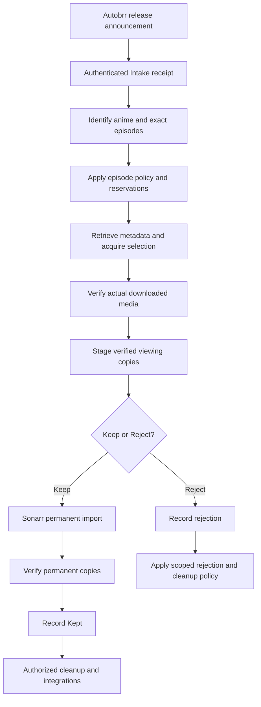

# Proposed system design: Intake → Staging → Keep or Reject

Status: planning draft, recorded 2026-10-23. No runtime behavior is changed.
This document develops the product flow agreed in [Anime Intake](ANIME_INTAKE.md).
It is the current planning overview for that flow; the detailed technical
architecture documents remain references for durability and safety constraints.

## Purpose and user experience

The application collects incoming anime, prepares selected episodes so the user
can consider them, and makes content permanent only after an explicit Keep.
It coordinates other systems instead of replacing Autobrr, qBittorrent,
Jellyfin or Sonarr.

**Intake** receives and processes release information. **Staging** prepares
verified viewing copies. **Staged** means available for the user's decision.
**Keep** requests permanent import; **Kept** means that import was verified.
**Reject** records the decision not to retain/follow the anime.

These are product phases and milestones, not a replacement jobs table or new
database job-state vocabulary. One phase can involve several independent jobs.
The final page layout and application branding remain undecided.

## End-to-end flow

Every processing step can wait or need attention. The diagram is the successful
product path, not permission to skip failure handling or automatically retry a
destructive operation.

### 1. Receive into Intake

Autobrr supplies a release announcement, not an already verified video. The API
validates webhook authentication and bounded input, normalizes supported release
fields, and durably commits the delivery plus its initial job before acknowledging.
The worker performs the subsequent work.

Retain each accepted delivery independently. Do not discard a notification just
because another has the same title, anime or torrent hash. Exact-resource
reservations later prevent duplicate acquisition. Strip credentials from stored
intake data and keep webhook access separate from management access.

### 2. Identify and select

Resolve the AniDB anime and the verified TVDB series relationship. Resolve exact
episode identities separately; a valid series with an empty episode list does
not authorize downloading or importing unidentified episodes.

Apply the configured episode window, reservations and size limits. Search for
missing selected episodes is a separate component: selecting episode numbers
does not prove sources have been found. Incoming releases and searched results
must pass the same identity and acquisition checks. Ambiguity goes to review.

Keep different AniDB entries distinct even when they share a TVDB series.
Season/episode filenames are hints rather than proof. Specials, parts,
multi-episode files and packs need explicit supported evidence; unsupported cases
must remain visible instead of being silently guessed.

### 3. Acquire selected media

Obtain the actual torrent metadata through a trusted retrieval adapter. Validate
the exact torrent hash, file inventory and selected bytes against the approved
plan. This adapter is an implementation gap, not functionality supplied by the
existing metadata parser alone.

Record a durable submission intent before adding an application-owned torrent
stopped. Reconcile its ownership, destination, category and exact inventory before
selection and startup. Select only approved media and monitor selected-file
progress through bounded checks that release worker capacity between attempts.
Preserve the current conservative shared-piece restriction until separately
reviewed.

Lost responses and crashes require reconciliation of the saved intent and client
inventory. They do not authorize another blind add/start/delete. Existing or
shared torrents cannot be treated as application-owned based on their name or
category.

### 4. Verify and stage

A client reporting complete is the handoff to local verification. Recheck the
recorded file, ownership, safe path, completeness and supported media; inspect
the actual file for required Japanese and English audio.

Prepare a copy in the destination filesystem, verify its integrity and source
stability, apply configured permissions, then publish without overwriting another
file. Bind the published artifact to its exact identity and manifest. Generate
the naming and NFO metadata needed by the chosen viewing layout.

Register temporary files and publication intent before they need recovery.
On interruption, reconcile existing copies rather than blindly copying again.
A metadata or Jellyfin refresh failure must preserve an already verified published
video and report the remaining work separately.

Commit successful staging and its artifact evidence together with job completion.
The user can then watch and decide. Whether the user-facing Staged/Ready to watch
milestone also requires a successful Jellyfin refresh is still an open policy
question; file publication and refresh acceptance are different facts.

### 5. Keep or Reject

Keep freezes the exact reviewed scope and manifest. New arrivals do not silently
join an approved import. Validate source files and identity again after a long
review interval, resolve the exact Sonarr series/root/profile and request the
approved copy import. Reconcile uncertain submissions before another import.

A Sonarr command accepted or completed is not enough to say Kept. Confirm the
expected permanent files and episode bindings and verify content against the
approved manifest. Record Kept only after that proof is committed. Separately
report source cleanup or optional integration failures without importing again
or deleting good permanent copies.

Reject is distinct from Cancel. Its proposed responsibility is to record that
the user does not want this anime and prevent subsequent incoming content from
bypassing that decision. Exact identity scope, treatment of concurrent work,
reset/reconsideration and authorized staged-file cleanup remain to be specified.
Do not infer directory-wide deletion permission from a Reject click.

## Responsibility boundaries

| Component | Responsibility |
| --- | --- |
| API process | Authenticated intake, management admission, settings/status/history reads and durable action receipts |
| Worker process | Bounded job scheduling, leases, recovery, heartbeats and atomic completion/follow-up commits |
| Feature libraries | Identity, selection, metadata retrieval, client operations, verification, staging and import rules |
| Dashboard and admin client | Call the management API and explain state/action availability; never directly mutate SQLite or media |
| Supervisor | Start, stop and observe processes; it does not implement acquisition policy |
| External services | Autobrr announces, qBittorrent transfers, Jellyfin presents viewing content and Sonarr manages permanent import |

Keep the current independent job model. A worker validates its current lease
before committing feature results, completion and permitted successor jobs in
one transaction. Provenance is not a parent/child lifecycle. Long waits become
scheduled checks, not running handlers holding capacity.

## Storage and recovery contracts

Keep three physical roles: download working data, staged viewing copies and
permanent library files. Intake is a product phase, not a requirement for a fourth
media directory. Existing internal `storage.trial_root` can represent the
staging destination; the proposed user-facing label is **Staging folder**.
Keep existing internal trial identifiers and keys unless a later feature
requires an explicit migration.

Freeze artifact roots, paths, identity, content evidence and relevant settings
when an operation is planned. New settings must not silently retarget an old
cleanup/import. Validate containment and permissions and reject dangerous root
overlap, symlinks and unrelated-file collisions.

SQLite cannot transact atomically with remote services or the filesystem.
Durable intents, observed receipts, manifests and independent verification bridge
that boundary. Episode reservations stay protected until their documented
release conditions are satisfied; automatic slot release remains an open policy.

## Actions and user-facing messages

| Situation | Intended presentation and action |
| --- | --- |
| Action durably admitted | Job submitted; return the job reference and status links |
| Action queued | Disable duplicate/competing actions with an accurate queued explanation |
| Action running | A job is already in progress |
| Waiting, held, blocked or review required | Explain the real condition; offer safe cancellation/recovery where applicable |
| Unfinished acquisition canceled | Stop advancement, drain active work and track owned-resource cleanup durably |
| Successfully staged | Available for Keep or Reject; acquisition Cancel is no longer appropriate |
| Keep submitted | Show import progress; do not claim permanent success yet |
| Permanent copies verified | Kept; show cleanup/integration status separately if needed |

Messages and disabled-action explanations use the shared diagnostic catalog and
stable keys. The dashboard will implement styling and hover behavior later.
Cancellation cleanup must not cancel its own control job, touch shared/unowned
resources or remove verified permanent copies. Resuming a review-stopped operation
requires the explicit supported recovery action, not an invisible automatic reset.

## Implementation map and order

This inventory is based on source review of the stacked feature work through
PR #120 (reference commit `1a4293ba5408bfd66006cd2b57ec0aedc3c8a654`).
It does not assert those drafts are merged into NextGen or runtime-tested.

| Area | Source-review boundary |
| --- | --- |
| Intake/API, identity, episode-window selection and reservations | Foundations and feature libraries exist in the reviewed work |
| Torrent preparation, size admission, stopped submission and transfer journal | Libraries exist; real metadata retrieval/composition is unfinished |
| Cancel and cleanup action admission | Durable implementation exists in draft work |
| Local video/audio verification and staging publication | To implement beyond existing cancellation artifact hooks |
| Keep | Admission boundary exists; actual media promotion remains blocked |
| Reject and reconsideration | End-to-end decision policy/storage/API still to design and implement |
| Missing-episode search and broader release support | Additional work; conservative review remains the current boundary |
| Jellyfin, Shoko and reminders | NextGen integrations still to implement |
| Dashboard, complete admin/control surface and supervision | Future implementation |
| Validation | Source checks only; offline tests and CI remain unexecuted |

Suggested sequence: settle the open staging/decision policies; complete metadata
retrieval and its worker composition; implement local verification and staging;
implement scoped review decisions and permanent import; add integrations and
remaining management operations; build the dashboard and supervision; then
perform the explicitly authorized testing and deployment validation.

This PR is documentation only. It introduces no feature handlers, migrations,
configuration changes, live service calls, media operations or deployment.
