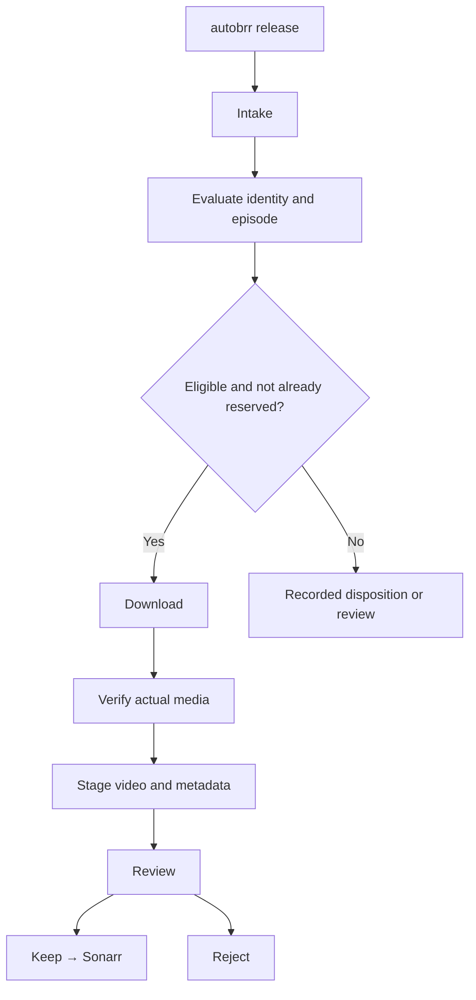

# Intake through staging — NextGen design

**Status:** agreed flow and code-oriented reference, not a claim of successful lab operation. Read with [the architecture overview](README.md), [episode selection](../EPISODE_SELECTION_POLICY.md) and [Keep](KEEP_TO_LIBRARY.md).

## One flow

**No search provider is part of this workflow.** NextGen does not discover indexer results, query Prowlarr, or download missing window positions on its own. A different application can search independently. A later incoming autobrr delivery is evaluated using the same existing intake pathway.

## Step responsibilities

| Step | Required behavior | Evidence or outcome |
| --- | --- | --- |
| Intake | Authenticate/accept autobrr delivery, durably record receipt and initial work. | Delivery record; a received title is input, not proof of identity. |
| Evaluate | Confirm AniDB anime/episode and verified TVDB mapping, identify exact declared release coverage, apply episode selection, prevent conflicting reservations. | Immutable episode identities, selected/held/review reason and recorded plan. |
| Download | Use the existing approved source and qBittorrent path; reconcile submission, selection and progress. | Durable ownership, download receipts, selected file manifest and budgets. |
| Verify | Check downloaded bytes, episode coverage, container/video and required Japanese and English audio; reject ambiguous evidence. | Verified media evidence, not a filename guess. |
| Stage | Move the authorized verified video and write episode metadata/NFO into the configured staging directory; no destination video hash or byte comparison. | Verified reviewable file references and immutable publication evidence. |
| Review | Expose the staged video and evidence; await explicit human Keep or Reject. | No implicit permanent import. |
| Keep | Call journaled Sonarr copy import for the exact verified TVDB episode, then confirm the episode binding and readable permanent file at its expected size, without destination hashing. | Permanent file proof before recording successful Keep. |
| Reject | Record anime decision and remove only the selected owned staging video/NFO when safe. | Independent decision and cleanup result. |

Jellyfin refresh may be queued independently after stage or after verified Keep. A failed scan request must not undo either operation. Shoko may enrich AniDB metadata as a separately optional integration; it does not own moves, naming or Sonarr's TVDB episode selection.

## Reliability and ownership

- Worker lease-fenced completion commits job status, associated evidence, history and any successor work **atomically** in SQLite. A handler does not separately commit its own DONE status and successor job.
- A plan identifies an exact AniDB anime, TVDB series, official season and received episode; a shared TVDB series must not merge distinct AniDB scopes.
- Episode reservations protect against duplicate acquisition; repeated deliveries remain individually auditable.
- Filename/title and feed metadata are inputs, never enough to certify file identity or authorization for a destructive action.
- Keep and Reject are mutually controlled management decisions; a staging milestone alone is not a valid proof of file contents.
- Configuration paths for downloading, staging and the permanent Sonarr library must remain separate. NFS permissions, file ownership and path visibility require real lab checks.
- Cancellation/recovery never removes unowned or uncertain source data; only explicitly recorded, verified artifacts can be cleaned.
- User-facing progress, errors and recovery actions are resolved centrally from machine event/reason codes via [the message catalog](../HUMAN_READABLE_MESSAGES.md).

## Existing implementations versus unfinished work

The current draft stack has source for the stages above, including a staging manifest, Reject action, Keep journal and Jellyfin refresh jobs. It does **not** establish that those pieces function together in the lab. Additional work remains for cancellation reservation release, torrent/download cleanup and uncertain-command operator reconciliation, optional Shoko, deployment/service lifecycle, and permitted end-to-end verification.

Earlier exploratory design and proposed job names remain in Git history. **Do not restore outdated search assumptions or unimplemented job-kind proposals as though they were installed handlers.**
