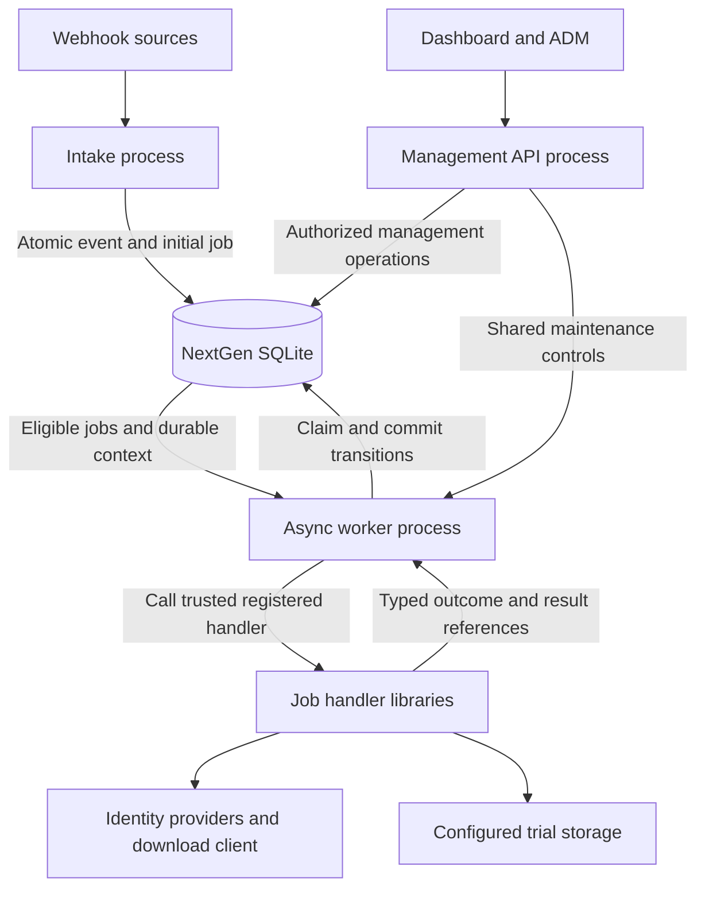
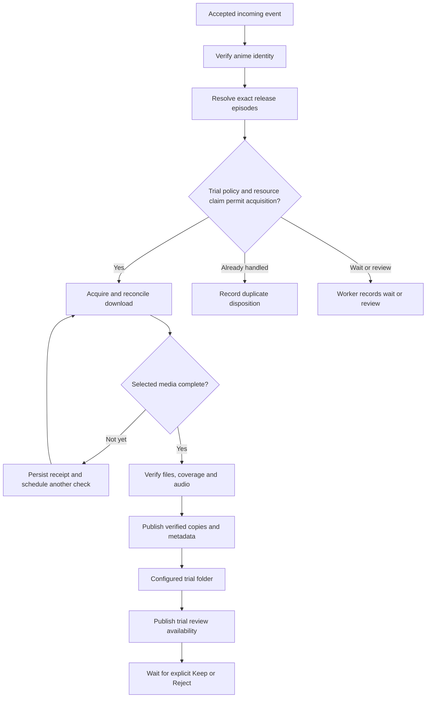

# Architecture proposal: intake to the trial folder

Status: **planning draft for review, not implemented pipeline behavior**.
Date: 2026-10-22. Read alongside [Keep to library](KEEP_TO_LIBRARY.md).
This design uses existing incoming_events, independent jobs and their histories;
it does not introduce work_items, a to-do table or a parent/child workflow graph.
The naming/history foundations in PRs #103/#104 are prerequisites still subject
to their own review/merge status.

## Responsibility and process graph

**The worker owns pipeline advancement.** A handler reports what happened; it
never marks its own queued job DONE and separately hopes a successor appears.
The worker validates its lease and commits job completion, feature result facts,
permitted successor jobs and associated audit records in one SQLite transaction.
The successor is a normal independently claimable PENDING job.

The management API and worker are separate processes. Webhook acceptance belongs
to intake; a reverse proxy may expose intake under the same public host without
turning the management API into the worker. Intake durably accepts each delivery
once per receipt; GUID/title/series matches do not discard independent deliveries.
An HTTP success follows the commit, never precedes it. Producer retries can still
produce multiple deliveries; downstream exact-resource gates handle duplication.

The API-to-worker control edge describes the agreed pause/drain/readiness
boundary, not an implemented RPC transport. The shared maintenance gate blocks
new admissions and waits for already admitted operations; SQLite carries durable
job state. Authentication, API transport and later supervisor wiring remain future
work. Supervisor, when implemented, manages processes; the worker manages jobs.

## Proposed processing graph

The nodes describe business stages, not new SQL states. Each completed stage
returns to the worker for its atomic handoff. Names below are candidate kinds
and `_job.py` modules, not installed handlers or registered event/reason codes.

Failures at any stage return a typed retry/hold/review/failure outcome to the
worker; the graph's waiting branch is illustrative, not permission to ignore
such outcomes elsewhere. Human review is not a running handler holding a lease.
A staged job can be DONE with no automatic Keep successor. Keep starts the
separate authorized flow in the companion architecture file.

| Proposed job kind / module | Handler responsibility | Worker handoff on validated success |
| --- | --- | --- |
| IDENTIFY_ANIME / identify_anime_job.py | Verify AniDB anime ID, TVDB series ID and title; reuse applicable verified identity evidence | Persist validated AnimeSeries result; enqueue release verification |
| VERIFY_RELEASE / verify_release_job.py | Establish exact AniDB episode coverage for this release; apply trial eligibility policy and exact-resource claim | Enqueue acquisition only when its prerequisites pass; otherwise park or end with a documented disposition |
| ACQUIRE_TRIAL_MEDIA / acquire_trial_media_job.py | Reconcile/add approved torrent selection, persist ownership and receipts, inspect selected-file progress | Defer while downloading; enqueue media verification after selected content completes |
| VERIFY_TRIAL_MEDIA / verify_trial_media_job.py | Match actual files to approved episodes; verify completeness, supported media and required Japanese/English audio | Persist verified media manifest; enqueue staging |
| STAGE_TRIAL_MEDIA / stage_trial_media_job.py | Create verified trial copies, safe names, metadata and effective permissions | Commit published artifact references; enqueue trial-review publication |
| PUBLISH_TRIAL_REVIEW / publish_trial_review_job.py | Reconcile required metadata/readability and make the verified trial available for browsing/review | Persist review availability; finish with no automatic permanent import |

These boundaries may be combined or split during review. Download waits should
release worker capacity: commit known receipt/progress and schedule a bounded
future check rather than keeping an idle task/transaction alive indefinitely.
Jellyfin refresh/notification delivery can be independent retryable follow-ups;
a notification outage does not destroy a valid staged video. Which integration
must succeed before the UI says trial-ready is an explicit decision below.

## Identity and eligibility gates

AnimeSeries v2 success proves a series identity only. Its episode list may be
empty, which is valid but does **not** authorize acquisition/staging of an
unidentified episode. Provider-verified AniDB episode IDs and exact release/file
coverage are separate prerequisites for episode-specific actions. A season-pack
label does not prove contents; selected files must match the approved manifest.

AniDB identifies anime/episode ownership. Multiple AniDB entries can share one
TVDB series ID; do not serialize or merge them merely by that shared ID. Never
infer a season from AniDB numbering or a release filename. TVDB episode placement
is required when a chosen output naming/NFO/import operation needs it. A verified
special can use season zero where the destination supports that mapping. The
legacy staging helper's positive-season-only restriction is not a NextGen rule.

Policy decides the allowed trial window and file/size limits before acquisition.
Legacy code provides a six-episode regular-window reference and independently
verified part/ongoing boundaries. That does not settle the NextGen configurable
window count, specials or ongoing-discovery behavior. No filename chooses a new
trial boundary, and no backfill/search system is implicitly implemented here.

## How the worker advances a job

1. With capacity available, take maintenance admission, capture one validated
   configuration snapshot and atomically claim an eligible job with a fresh
   lease token. Release admission promptly if there is no claim. Held, review,
   blocked, canceled and completed jobs are not automatically claimed.
2. Resolve the registered kind to trusted callable/handler metadata. Record
   HANDLER_STARTED with job ID, current attempt, stable handler code/label and
   fresh invocation ID before calling it. Commit before external work begins.
3. Invoke the handler asynchronously. Offload blocking filesystem/SQLite/client
   calls to threads where necessary; no child process per job is implied. Keep
   lease heartbeats and the attempt's maintenance admission while actively doing
   work. Each attempt retains its settings snapshot; startup-only settings stay
   pinned until restart.
4. Receive a structured outcome: completed, deferred retry, condition hold,
   review required or failure. Outcome names here describe the proposed contract;
   the exact Python types are to be designed before worker implementation.
5. In one short transaction, verify RUNNING state, matching token and unexpired
   lease; use the feature's registered persistence/routing adapter to validate
   result references and choose allowed successors; record handler ending,
   persist completion facts, transition the job, insert successors and history.
   Clear/release lease fields as required by the selected transition. Commit.
6. Emit safe readable logs only after commit; release admission/capacity. Polling
   finds the new job normally. The worker must not advance the same DONE row
   repeatedly or use a startup scan of all DONE rows as a second routing system.

The worker owns the transaction and scheduling. Feature adapters own the domain
rules; it need not contain AniDB matching, torrent selection, probing or file
copy logic. A handler may report a permitted follow-up intent, but it cannot
supply arbitrary executable names or mutate queue state outside this handoff.
Only registered routing can create successors. No generic hooks or dynamically
loaded filename from a payload are introduced.

HANDLER_COMPLETED records a successful call; it is not itself jobs.DONE. When
one queued job calls several handlers, intermediate call endings can be durable
while the job is still RUNNING. The final validated job outcome controls the
atomic completion/successor handoff. Successor provenance uses the existing
created_by_job_id field and never implies a parent/child dependency.

## Filesystem layout and configuration proposal

Three roots have different purposes:

| Proposed setting | Purpose | Rule |
| --- | --- | --- |
| storage.download_root | Download-client working/source content | Keep torrent source and ownership evidence separate from published files |
| storage.trial_root | Configurable review destination requested by the user | Stage validated video and required sidecars here; this is not the permanent library |
| storage.keep_root | Permanent library destination, discussed in the Keep design | Never select it merely because a torrent completed |

trial_root and keep_root are now registered in configuration v3 with blank
unconfigured defaults. download_root remains a future acquisition setting.
Add actual fields, validation/apply metadata and offline cases in their component
PRs; do not silently assume legacy settings are accepted. Exact keys are proposals.
Validate directory existence, safe containment, access and effective service
permissions before use. Reject overlapping source/trial/permanent roots where
cleanup or publication would affect another root. Do not run the worker as root
or perform opportunistic ownership repair to bypass an invalid installation.

A new operation uses current validated settings, but an existing artifact keeps
its recorded root, path and configuration revision. Changing trial_root controls
new destinations; it must not silently relocate old files or reinterpret an old
manifest against a new root. Root retirement/movement needs explicit reconciliation.

Staging creates a temporary copy in the destination filesystem, verifies byte
integrity and unchanged source, applies configured modes/group, synchronizes and
publishes without overwriting an existing media file. Validate metadata identity
and readability; preserve the source and any already-published verified video if
metadata/refresh fails. Recover from persisted intent plus verified filesystem
state, rather than copying again blindly. A preexisting destination requires
identity/content reconciliation, never an unconditional overwrite.

## Concurrency, durability and visibility

- Independent jobs for the same anime can run concurrently. Provider libraries
  own shared pacing; acquisition/publication libraries atomically gate the exact
  episode/content/destination they protect. A busy gate returns a typed defer,
  hold or duplicate outcome; it does not impose whole-anime serialization.
- Each delivery retains its event ID. Jobs retain event_id when applicable and
  created_by_job_id provenance for successors. job_history carries job attempt,
  handler invocation, codes, static messages and sanitized bounded facts.
- SQLite cannot atomically commit with a torrent client, Sonarr or filesystem.
  External-operation intents, receipts/manifests and reconciliation make retries
  recoverable; do not claim exactly-once side effects. An expired worker cannot
  commit SQLite completion. External fencing/idempotency requires its own gates.
- An uncertain external submission is reconciled by its stable request/resource
  identity before any resubmission. Database errors never cause blind replay.
- Maintenance stops new attempts and lets admitted work drain. It does not cancel
  queued jobs, rewrite attempts or clear deadlines. Existing expiration recovery
  remains fenced worker policy after resume.

## Persisted contracts still to design

The existing schema supports intake, identity snapshots, independent queue and
handler history. It does not yet store the complete trial policy/claims,
download ownership receipts, artifact manifests, review decisions, external
operation intents or publication progress described above. Each feature must
add its required versioned SQL, fresh schema, storage helpers and offline tests
in the same PR. No fields are added to AnimeSeries to avoid operational storage.
No work_items redesign is implied by these future component-specific records.

## Decisions to review before implementing this flow

1. Trial window count/default and policy for parts, ongoing series, specials,
   multi-episode files and packs. Confirm whether an E01-first requirement is
   needed; do not carry it forward accidentally from a legacy UI label.
2. Exact trial folder layout and metadata rules: names, series separation when
   AniDB entries share a TVDB series, verified season-zero handling, required NFOs.
3. Whether trial-ready requires successful Jellyfin refresh or only verified
   files/metadata/readability, with integration refresh shown separately.
4. Exact handler outcome types, registered routes and atomic persistence adapters.
5. Setting names/apply rules and how existing artifacts survive root changes.

## Legacy references used for this proposal

Reviewed at repository commit `6051cedddd5a09de0cb3150565288205d5a92aee`:
[anime_acquisition_gate.py](https://github.com/bugz8unny69/anime-discovery/blob/6051cedddd5a09de0cb3150565288205d5a92aee/src/legacy/anime_acquisition_gate.py),
[anime_claimed_pipeline.py](https://github.com/bugz8unny69/anime-discovery/blob/6051cedddd5a09de0cb3150565288205d5a92aee/src/legacy/anime_claimed_pipeline.py),
[anime_media_completion.py](https://github.com/bugz8unny69/anime-discovery/blob/6051cedddd5a09de0cb3150565288205d5a92aee/src/legacy/anime_media_completion.py),
[anime_trial_staging.py](https://github.com/bugz8unny69/anime-discovery/blob/6051cedddd5a09de0cb3150565288205d5a92aee/src/legacy/anime_trial_staging.py),
[anime_trial_policy.py](https://github.com/bugz8unny69/anime-discovery/blob/6051cedddd5a09de0cb3150565288205d5a92aee/src/legacy/anime_trial_policy.py).
These include conservative/reference helpers; this review does not assert that
all were registered in the legacy live daemon. Reuse validated behavior and
focused libraries where suitable, not its daemon architecture or SQL tables.
