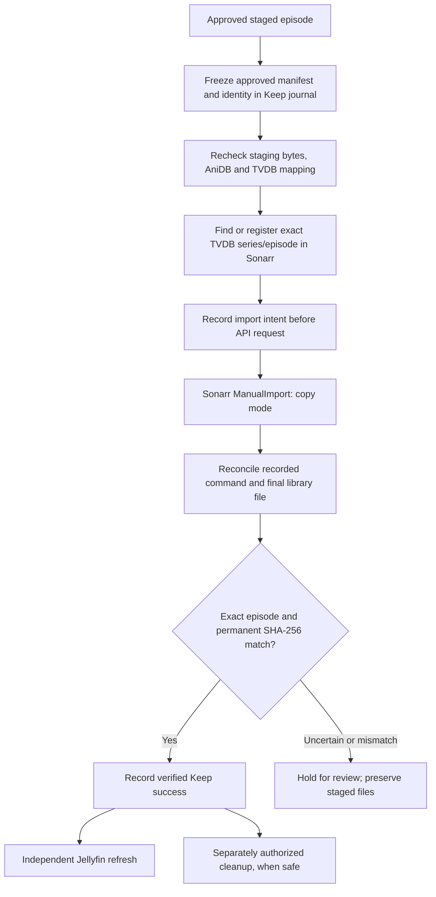

# Keep to the permanent library — NextGen design

**Status:** an initial one-episode implementation exists in untested draft [PR #129](https://github.com/bugz8unny69/anime-discovery/pull/129), with independent Jellyfin refresh in [PR #130](https://github.com/bugz8unny69/anime-discovery/pull/130). This document specifies the safety contract; it is not a declaration of lab readiness.

After [Intake through staging](INTAKE_TO_STAGING.md) has produced a verified staging video and metadata, the reviewer explicitly chooses **Keep**. Sonarr is the sole manager of permanent anime file placement/renaming. Shoko is optional metadata-only integration, never the mover and never a gate on Sonarr.

## Keep sequence

## Required invariants

1. The authenticated management API freezes an explicit approved **single-episode** staging manifest and exact AniDB/TVDB/Sonarr identity. Neither an arbitrary supplied path nor a matching title alone can authorize import.
2. Verify the staging file signature, digest and approved episode identity again before import. Existing destination episodes, conflicting series settings and changed files require review; never overwrite silently.
3. Use the exact TVDB-linked Sonarr series, canonical season/episode and explicit Sonarr episode ID. Sonarr owns the permanent root, profile, copy import and final file location.
4. Persist external import **intent before submitting** ManualImport in copy mode. If Sonarr's response is lost, a worker restart does not blindly resubmit. Reconcile the journal, command state and actual files first.
5. Sonarr HTTP acknowledgment or command completion is **not** proof of Keep success. Independently verify a permanent file with the correct episode identity and matching SHA-256, and ensure the staged source remains distinct.
6. Mark Keep successful only after verifiable permanent proof. Cleanup and Jellyfin refresh are independent follow-ups; their failure does not roll back a verified permanent file.
7. Never delete staged media, torrent source files or shared metadata when ownership, destination evidence or import outcome is uncertain. Reject is a separate explicit decision.

## Decisions and bounds

The initial draft intentionally supports one selected episode per Keep. A second Keep click must reuse/reconcile the existing authorized action rather than create a duplicate import. Multi-episode bulk promotions, automatic staging cleanup after Keep, and automated resolution of uncertain Sonarr submissions are not implemented. Direct filesystem promotion is **not** a fallback when Sonarr is unavailable.

The review folder, download folder and permanent library are distinct configured roots; real NFS mounts, UID/GID permissions, Sonarr source-to-destination path visibility and rollback behavior must be verified in the lab.

Jellyfin's library-wide refresh request is accepted independently of staging/Keep; acceptance does **not** guarantee scanning/indexing finished. Optional Shoko must never rename or move Sonarr-managed files.

## Operator-readable diagnostics

Each failure must use a registered reason with a stable code, human English message and a separate suggested action; operator UI resolves them from [the central catalog](../HUMAN_READABLE_MESSAGES.md). For example, uncertain submissions use `KEEP_COMMAND_UNCERTAIN`, destination identity/reconciliation issues use `SONARR_IMPORT_REVIEW`, and verified staging-file mismatches use `KEEP_FILE_REVIEW`. Do not display raw exception strings or release titles as errors.

**Draft-only:** no test suite, live Sonarr import, SQL migration, browser check, service restart, merge or deployment has been performed as part of this design update.
