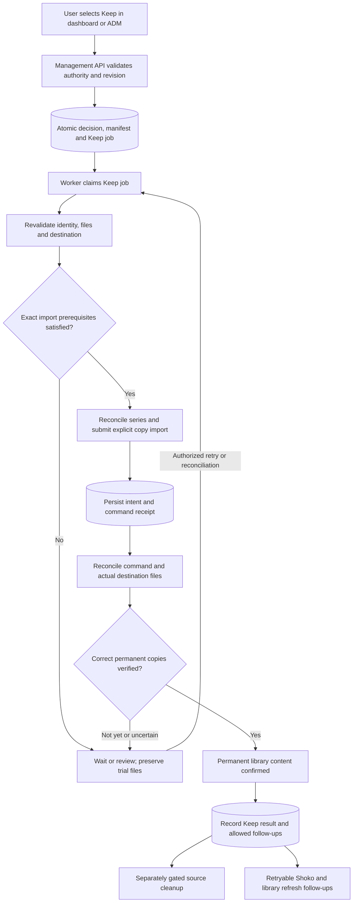

# Architecture proposal: Keep to the permanent library

Status: **planning draft for review, not implemented behavior**.
Date: 2026-10-22. Starts after [intake to trial](INTAKE_TO_TRIAL.md) has produced
verified trial artifacts. No code, configuration fields, SQL or cleanup is
implemented/authorized by this document.

Working assumption: the user's "default directory" is the configured permanent
library root, and Sonarr owns admission/import into it, following legacy behavior.
This is separate from both download_root and trial_root. Direct filesystem
promotion instead of Sonarr is an alternative requiring an explicit decision;
it is not a silent fallback when Sonarr is unavailable.

## Keep request and import graph

The receipt node represents durable reconciliation state, not an atomic
transaction with Sonarr. Persist the external-operation intent **before** the
submission; persist the command receipt afterward. A command accepted/completed
by Sonarr alone does not prove the expected permanent file exists or is correct.
If a response is lost, reconcile that intent before considering a new submission.

## What Keep authorizes

The dashboard and ADM use the same authenticated management API and authorization
model. Clients never write configuration, SQLite or files directly. The API
accepts a stable reviewed identity/trial-unit reference, expected review/manifest
revision and idempotency key, not an arbitrary source path, destination path or
Python module. It checks that this decision is still applicable and atomically
records the approved scope plus its initial queued job. It responds "Keep
accepted" after commit, not "Kept" while files are still being imported.

Proposed scope: the selected verified AniDB anime/trial unit and the exact
manifest shown for approval. A shared TVDB series ID alone is not enough to pick
that scope. New staged files arriving during Keep do not silently join a manifest
already approved/submitted. Refreshing scope is an explicit reconciled decision.
Any authorization to follow future episodes is a separate documented policy
choice, not an unlimited cleanup permission inferred from clicking Keep once.

Repeated clicks return the existing decision/job outcome rather than creating
multiple imports. Conflicting Keep/Reject requests, stale manifests and changed
identity require an atomic revision check and explicit resolution. Persist the
authorization facts needed for audit; never persist session/access tokens.
Decision storage/revisions are future feature schema, not currently implemented.

The API enqueues work; the **worker** advances it through registered routes.
A Keep handler does not change its own jobs row to DONE or enqueue an unrelated
next step after committing independently. The same atomic completion/successor
contract from the intake architecture applies here.

## Proposed responsibilities and handoffs

| Proposed kind / `_job.py` module | Handler responsibility | Successor or outcome owned by worker |
| --- | --- | --- |
| PREPARE_KEEP / prepare_keep_job.py | Revalidate approved scope, identity, source files, digests, exact episode mapping and target configuration | Persist immutable import plan; enqueue Sonarr admission |
| ENSURE_LIBRARY_SERIES / ensure_library_series_job.py | Resolve/add the exact Sonarr series and validate profile/root policy without guessing identity | Persist verified Sonarr series reference; enqueue import submission |
| SUBMIT_LIBRARY_IMPORT / submit_library_import_job.py | Reconcile prior intent, preview exact candidates, submit copy only when mapping/quality/language is valid | Persist command receipt and plan binding; enqueue import verification |
| VERIFY_LIBRARY_IMPORT / verify_library_import_job.py | Poll/reconcile command and independently verify actual permanent files against approved manifest | Defer while pending; on proof enqueue finalization; mismatches go to review |
| FINALIZE_KEEP / finalize_keep_job.py | Record the verified permanent-file outcome and permitted cleanup/integration intents | Finish the Keep decision; enqueue only explicitly permitted follow-ups |
| CLEANUP_TRIAL_SOURCES / cleanup_trial_sources_job.py | Recheck current ownership, references and file equivalence before each allowed source removal | Record cleanup results/notices independently from permanent import proof |

Names are proposals, not installed handler definitions or executable routing.
Shoko registration and Jellyfin/library refresh are optional independently
retryable follow-ups with their own `_job.py` modules when implemented.
A temporary refresh failure must not cause reimport or deletion of a verified
permanent video. No exact job-kind inventory is finalized by this graph.

## Preconditions before landing in the permanent directory

The Keep plan must bind each approved staged file to:

- Its verified AniDB anime/episode identities, source delivery/job provenance,
  and verified TVDB/Sonarr series and episode placement needed by this import.
- A verified readable regular media file under its recorded authorized trial
  root, with stable content digest/size, required Japanese/English audio and
  selected episode coverage. Revalidate after a long human-review interval.
- The intended permanent series/root and required quality/profile policy,
  including the relevant configuration revision and provider path mapping.
- An exact per-file import selection. A season pack cannot authorize unrelated
  files merely because they share the same torrent or source directory.

Sonarr's filename-derived identity prediction is not authoritative. Resolve
explicit series/episode IDs from verified evidence and confirm the preview's
actual source file. Ambiguous/missing mapping, rejected candidates, inaccessible
paths or missing language/quality facts stop automatic import and preserve
sources. A valid AnimeSeries with zero episodes cannot satisfy this gate.
Season zero is allowed when its provider mapping and target import support it;
continuous AniDB numbering is not automatically S01 numbering.

For an existing Sonarr series, verify its TVDB identity and actual destination.
Do not silently relocate it or rewrite its root/profile/monitoring to force a
match. Missing or conflicting registered roots/path mappings require review.
The configured target must be accessible to the responsible service; the API
cannot solve a Sonarr/NFS visibility problem by blindly chmod/chowning media.

Use copy semantics by default, preserving trial media until proof. Never request
MOVE as a shortcut. Hardlink/reflink support and what counts as an independent
copy require a separate explicit policy before enabling them. Do not overwrite
an existing library file solely because Keep was clicked: reconcile identity,
contents and any provider rejection first. An unrelated existing episode file
is not evidence that this particular trial file was imported.

## Evidence required after import

Before declaring permanent import verified, the verification handler must show:

1. The submitted/reconciled command is associated with this exact approved plan.
2. Sonarr's episode/file references match the planned series and episode IDs;
   command status and filename text alone are insufficient.
3. Every selected destination is present, readable, under the intended allowed
   permanent root, and distinct from trial/download source paths.
4. Destination size/digest/content equivalence matches the trusted staged
   manifest, including an idempotent recovery case where a source was already
   removed by an earlier verified cleanup with durable evidence.
5. No unexpected collision, partial selection or cross-series mapping remains.

A completed job records that step's evidence; it does not manufacture it. The
worker commits finalization facts and successor history only with its current,
unexpired lease. SQLite and external imports are not one transaction, so retries
reconcile the actual destination and existing receipts instead of importing
again blindly. Busy exact-resource gates schedule a defer/hold; whole-anime
serialization remains unnecessary.

## Finalization, cleanup and integrations

Proposed presentation distinguishes "Keep accepted", "Import pending", "Kept"
and "Cleanup pending/needs attention". These are business milestones to design,
**not new jobs.state values**. Independent queued jobs continue using existing
PENDING/RUNNING/RETRY_WAIT/ON_HOLD/NEEDS_REVIEW/DONE/BLOCKED/CANCELED states.

Record "Kept" only after permanent copies are verified and the durable Keep
result is committed. Cleanup may still be pending or intentionally preserve an
unowned/shared source; that must be visible without claiming the import failed.
If cleanup fails, retry/review cleanup itself, not the entire import. Never roll
back a correct permanent copy by deleting it to make a failed workflow look clean.

Source removal is a distinct policy and operation, not a side effect of an API
click or successful HTTP response. At cleanup time recheck:

- The destination still matches the approved verified-copy evidence.
- Each removable trial path is the exact application-owned published artifact;
  preserve unrelated trial files, sidecars and other review units.
- Torrent ownership is positively established at acquisition and still true.
  Category/name/save-path alone never proves ownership. External/preexisting/
  uncertain torrents remain untouched and get a readable disposition notice.
- The torrent is not shared with another series, incomplete job or unapproved
  release, and every selected completed media file is accounted for. Zero-priority
  unselected pack members must not be mistaken for imported content.
- Download, trial and permanent roots do not overlap dangerously; reject symlinks,
  path traversal and configuration changes that reinterpret recorded artifacts.

Keep the removal intent and completion evidence durable and reconcile partial
cleanup on retry. Do not delete all files in a directory or remove a torrent's
payload until the configured authorization and full owned-payload checks pass.
The exact retention/seeding/cleanup policy is a review decision below; this draft
executes and authorizes no deletion or production change.

When Shoko integration is enabled, record a retryable handoff of the verified
permanent file plus exact identity/provenance. Shoko API availability is not a
prerequisite for proven Sonarr import or safe authorized source cleanup. A failure
to persist a required follow-up intent is a database transaction failure, which
must be retried/reconciled; it is different from a later remote Shoko outage.
Never use speculative Shoko/VFS contents as proof that Keep imported the file.

## Configuration and storage boundaries

trial_root, download_root, permanent/Sonarr root, quality profile, provider path
mapping, permissions, retention and integration settings must be registered and
validated when those features are implemented. Their exact NextGen keys/apply
modes are not finalized here; current schema v2 does not accept all legacy keys.
The default/permanent folder is configurable; it is not hard-coded in a handler.

Freeze the approved plan's artifact/destination bindings and configuration
revision. A later setting change applies to new operations; it cannot retarget
an already-submitted import or turn an old cleanup path into a new destination.
Revalidate the bound plan on retry; if compatibility changes, pause for explicit
reconciliation. Do not silently create a second Keep decision to escape it.

Review decisions, manifests, import intents/receipts, file proofs, cleanup
references and integration handoff records need future component-specific
versioned SQL/fresh-schema/helpers/tests together. The existing jobs table and
handler history remain the execution/audit foundation. No work_items table or
unreviewed AnimeSeries fields are proposed.

## Decisions to review before implementation

1. Confirm Sonarr-managed import into its configured root as the final path, or
   explicitly choose direct filesystem promotion as a different design.
2. Keep scope: anime/trial unit and approved files, plus whether/how Sonarr should
   monitor future episodes. Legacy ensure_series enables monitoring without an
   automatic historical search; adopting that policy needs confirmation.
3. Copy-only policy, collision handling and whether any hardlink/reflink mode
   will be supported. Independent verified copy is the working default.
4. Whether/when to remove trial copies, retain torrent data/seeding, or preserve
   sources after a successful import. Define exact owned-payload cleanup scope.
5. Existing-series roots/profiles and container/NFS path-mapping behavior.
6. Which UI milestone signals success and how optional Shoko/refresh/cleanup
   notices appear without restarting an already completed import.

## Legacy references used for this proposal

Reviewed at repository commit `6051cedddd5a09de0cb3150565288205d5a92aee`:
[anime_sonarr.py](https://github.com/bugz8unny69/anime-discovery/blob/6051cedddd5a09de0cb3150565288205d5a92aee/src/legacy/anime_sonarr.py),
[anime_sonarr_import.py](https://github.com/bugz8unny69/anime-discovery/blob/6051cedddd5a09de0cb3150565288205d5a92aee/src/legacy/anime_sonarr_import.py),
[anime_sonarr_finalize.py](https://github.com/bugz8unny69/anime-discovery/blob/6051cedddd5a09de0cb3150565288205d5a92aee/src/legacy/anime_sonarr_finalize.py).
These provide behavior constraints, not NextGen runtime dependencies. The draft
separates import verification from recoverable cleanup rather than copying the
legacy controller structure or treating all helper code as production wiring.
