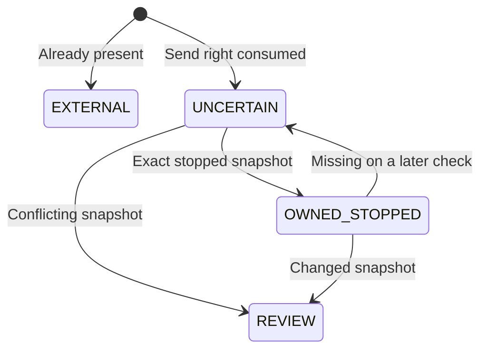

# Stopped torrent submission and durable reconciliation

SUBMIT_TORRENT / submit_torrent_job.py extends the explicitly composed metadata
pipeline after PREPARE_ACQUISITION. It adds a hash-bound .torrent stopped and
checks the result. DONE means only that a stopped torrent matches the saved
provenance and file inventory. It does not mean downloaded, audio-verified,
staged or kept. There is no start, stop-existing, file-priority, delete, re-add,
category-creation or metadata-fetch transport in this implementation.

## Composition and client transport

When build_identity_worker/run_identity_worker receives a trusted async
read_metainfo dependency, preparation now atomically enqueues SUBMIT_TORRENT with
its own preparation_job_id. Without that library the default pipeline still
ends at reservation. This is static library composition, not a hook/enable flag.
Client configuration and credentials are checked at point of use, not imposed
on unrelated identity jobs. Constructing a worker performs no client login/read.

The bounded acquisition/qbittorrent.py transport supports stable qBittorrent
4.5/4.6 and 5.x with WebAPI 2.8+. Login uses the central username/password and an
in-memory SID, then checks application/API versions. It sends fixed API paths,
uses configured request timeouts, verifies TLS normally, disables redirects and
ambient proxy forwarding, and performs no automatic request retry. Response JSON,
files, text and cookies are bounded and validated; malformed responses are never
classified as authoritative absence. No credential, cookie or response body is
logged or stored. No server preferences or global torrent settings are changed.

The official 5.0 wiki retains a legacy paused parameter example, but the release
5.0 implementation reads stopped. Version negotiation therefore chooses paused
for 4.5/4.6 and stopped for 5.x. Raw verified metainfo is uploaded once, with
manual torrent management, Original content layout, no alternate incomplete
folder and normal hash checking. New content goes beneath a unique ad-<marker>
child of the configured download root. These API operations are implemented but
have not been exercised against a live client.

Source references:
- [Official WebUI API](https://github.com/qbittorrent/qBittorrent/wiki/WebUI-API-%28qBittorrent-5.0%29)
- [4.5.2 add implementation](https://github.com/qbittorrent/qBittorrent/blob/release-4.5.2/src/webui/api/torrentscontroller.cpp)
- [5.0.0 add implementation](https://github.com/qbittorrent/qBittorrent/blob/release-5.0.0/src/webui/api/torrentscontroller.cpp)

## One-shot journal

Before client work, storage/submissions.py loads the completed preparation job
for the same event and rechecks reservation/evaluation/release evidence, body
digest, canonical identity, metadata declaration, selected bytes and frozen
budget. It reconstructs the bounded canonical inventory, never a payload-provided
URL, path, marker or file list. New attempts capture local options and current
private credentials. Once an intent exists, endpoint/destination/category/timeout
stay pinned to that intent; credential rotation is read fresh for that target.

For a new intent, the trusted reader re-fetches metainfo and its info hash,
SHA-256 and inventory must exactly match the prepared plan. Existing intents
require no reader call, only authoritative read-only client inspection.
The first exact-hash inventory query happens before any add:

- Already present: persist EXTERNAL and send nothing, regardless of category or
  apparent progress. An external torrent is never tagged, moved, paused or adopted.
- Absent: commit UNCERTAIN, immutable request fingerprint, version family,
  destination/options, first job/attempt and audit record before the possible add.
  Only that fresh insert returns a process-local single-use SendPermit.
- Existing journal: never return another send permit, including after absence,
  elapsed time, crash, canceled work, timeout, configuration change or expired lease.

The journal checks the current queue lease/attempt and source inside each short
transaction, and checks again before a permitted add. No network call holds a
SQLite transaction. Journal helpers run within the worker's existing maintenance
admission and do not take nested admissions. A one-use permit is consumed before
the sole transport call, without automatic retry on HTTP errors.

A crash after journal commit but before sending intentionally leaves UNCERTAIN
without a way to replay automatically. A timeout after the server accepted the
request has the same durable state. A subsequent attempt inspects the pinned
client; absence alone cannot distinguish those situations. Losing a permit can
require explicit future operator recovery after fencing old processes.

SQLite fencing cannot revoke a request after a final lease check has passed.
An old process could still send its one delayed stopped add, while its database
writes will be rejected. No replacement attempt receives a second authorization.
This is at-most-one authorized application send, not exactly-once delivery or
external fencing. Other applications can still race an external add. Isolated
paths, markers and independent observations constrain confirmation; no atomic
qBittorrent compare-and-add or exclusive control over other clients is claimed.

## Reconciliation and journal states

Confirmation requires the exact hash, saved unique marker (and no competing
application marker), destination, category, manual management, stopped state
and exact ordered file index/path/size inventory. A successful response, name,
category, missing files or same-hash presence alone never proves ownership.
Checking/metadata-pending snapshots stay UNCERTAIN. Active or contradictory
snapshots go to REVIEW without issuing corrective mutations. EXTERNAL/REVIEW
are terminal for automatic processing; there is no reset/release/rearm API.

Unresolved absence defers for a later read-only check. Connectivity failures use
normal bounded worker retries; authentication/unsupported/malformed responses
require readable review. The durable journal survives retry exhaustion. Confirmed
stopped snapshots can finish the job but do not authorize future control without
fresh checks. Observations may change after a receipt; the next transfer stage
must revalidate rather than treating an old snapshot as a permanent capability.

Journal progress and its audit history commit before the handler's final queue
transition. The queue still commits handler ending/job completion/history
atomically. A crash between them leaves recoverable external-operation progress,
not a false claim that queue completion already happened. A recovered attempt
rechecks the saved client state, never blindly repeats the external request.
Application log receipts are emitted only after their respective commits;
essential history is independent of log verbosity.

## Storage and remaining work

015_torrent_submissions.sql upgrades v14→v15 with one journal row per prepared
plan, pinned public request settings/fingerprint, first job/attempt, constrained
state/reason pairs and timestamps. It contains no metainfo, tracker URL, SID,
password or private key. Fresh DDL, storage helpers, runner, docs and offline
cases ship together; historical SQL 001–014 is unchanged. Configuration remains
v6, secrets v2 and AnimeSeries v2.

Next: enforce wanted/skip file selection and piece-overlap policy while stopped,
recheck ownership/inventory, then durably track start/progress before media
verification/staging. Also pending are a real read-only metainfo retrieval adapter,
operator reconciliation/reset controls and root retirement handling. This change
adds no filesystem mutation, actual application startup, live client request,
production migration or deployment during development.

Offline cases cover 4/5 API forms, auth/version/redirect/bounds/inventory checks,
provenance field mismatches, one-use permits, success/timeout/absence/crash paths,
pinned settings, pre-existing torrents, changed state and stale authorization/
confirmation, v14→v15 preservation/equivalence/rollback and sequential migration
coverage. Tests and CI remain intentionally unexecuted under project policy.
